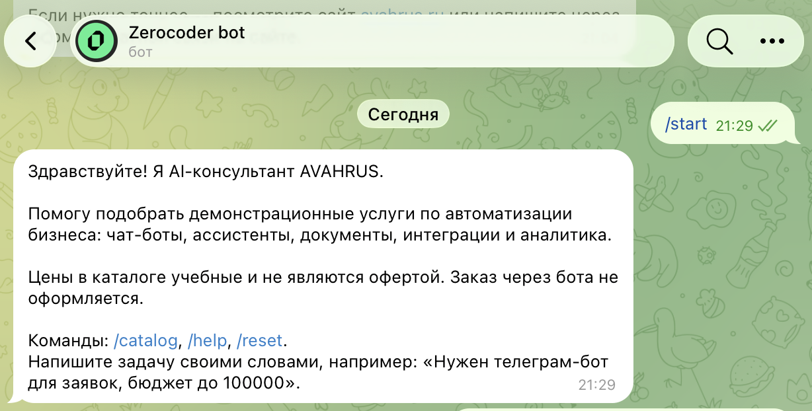
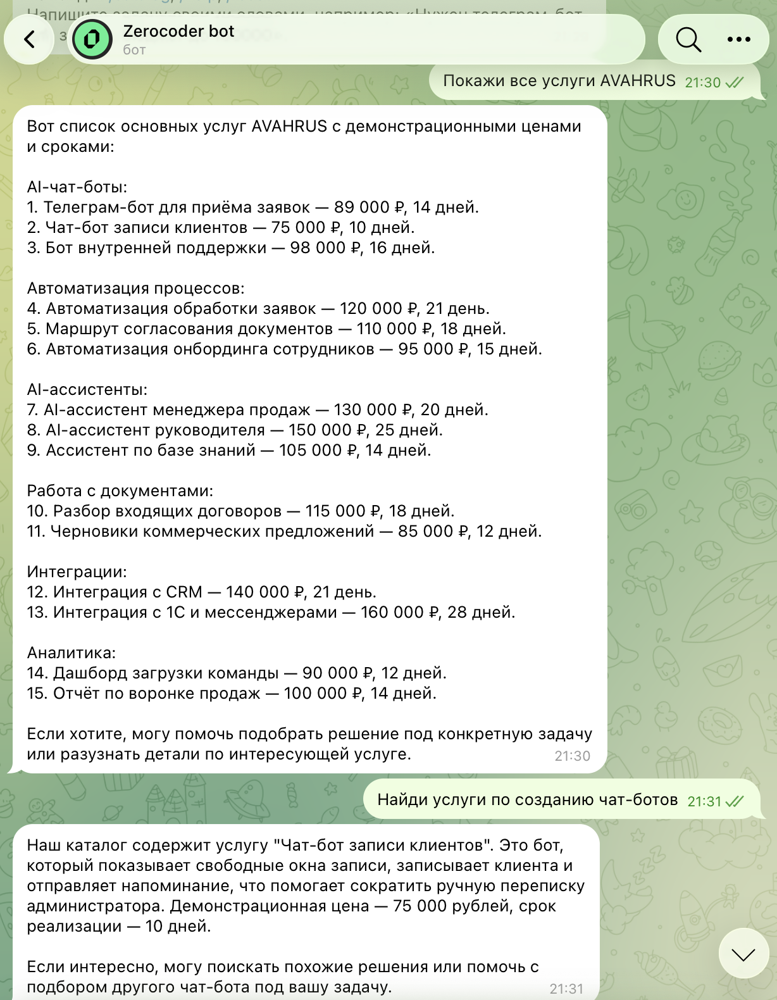
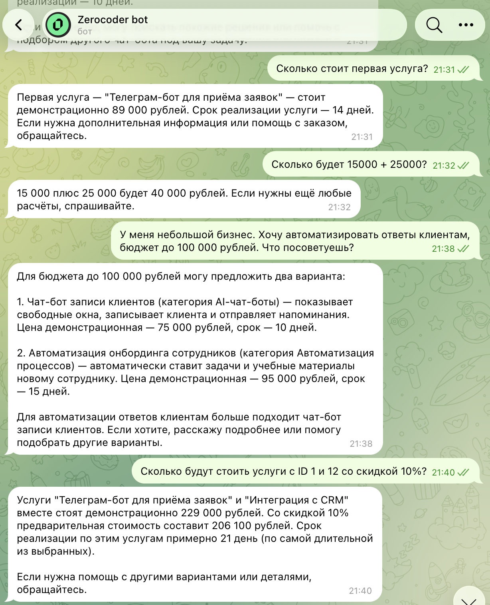
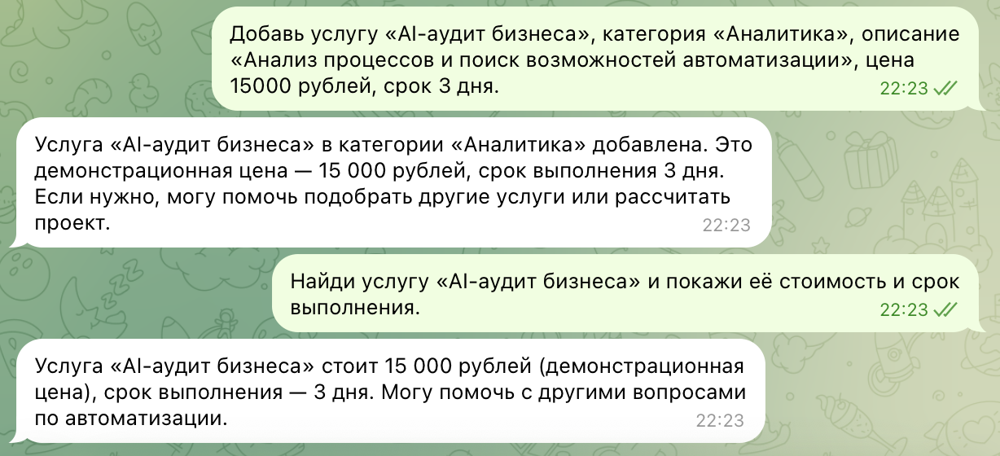

# product-mcp

Учебный Telegram-консультант AVAHRUS по услугам автоматизации бизнеса. Бот отвечает на русском языке, а актуальные услуги, цены и расчёты берёт из MCP-сервера, а не из текста промпта.

Каталог демонстрационный: 15 услуг в шести категориях, цены в рублях и не являются офертой. Бот не оформляет заказ.

## Возможности Telegram-бота

- `/start` — приветствие и подсказка, как сформулировать задачу.
- `/help` — краткий список возможностей.
- `/catalog` — активный каталог напрямую из MCP, без вызова языковой модели.
- `/reset` — очистить историю этого пользователя.
- Свободный текст уходит в OpenAI. Модель выбирает MCP-инструмент, бот выполняет его через официальный `ClientSession`.
- Поиск услуги по названию, категории или номеру.
- Подбор по описанию задачи: совпадение ключевых слов, не embeddings. Если указан бюджет, более дорогие услуги не предлагаются.
- Арифметика и предварительная оценка выбранных услуг со скидкой.
- Добавление услуги. Модель обязана вызвать `add_service`, а разрешит или запретит операцию MCP-сервер.
- Бот помнит последние 10 сообщений пользователя и не делает больше пяти вызовов инструментов на одно сообщение.
- Ошибки OpenAI и недоступность MCP показываются короткой фразой. Ключи и трассировки в чат не попадают.

## Архитектура

```text
Пользователь
    → Telegram (aiogram 3)
    → OpenAI tool calling
    → MCP ClientSession
    → Streamable HTTP  http://127.0.0.1:8000/mcp
    → FastMCP
    → SQLite services
```

Бот не подменяет MCP собственным REST. На каждый ответ он вызывает `list_tools()`, переводит схемы в формат OpenAI и выполняет выбранные инструменты через `call_tool()`.

Запись в каталог идёт только через `add_service`. В схеме этого инструмента нет поля с Telegram ID: бот подставляет заголовок `X-Telegram-User-Id` из апдейта Telegram, а сервер сравнивает его со списком `TELEGRAM_ADMIN_IDS` после проверки клиента.

По умолчанию сервер слушает `127.0.0.1`. Публичный адрес без `MCP_AUTH_TOKEN` процесс не запускает. Удалённый URL бот принимает только как `https://.../mcp` и только вместе с токеном. TLS можно завершить на обратном прокси либо сертификатами `MCP_SSL_CERTFILE` и `MCP_SSL_KEYFILE`.

## MCP-инструменты

| Инструмент | Назначение |
|---|---|
| `list_services` | Активный каталог. Можно сузить выборку категорией |
| `find_service` | Поиск по части названия без учёта регистра |
| `get_service_by_id` | Карточка услуги по номеру |
| `find_by_category` | Все активные услуги одной категории |
| `add_service` | Добавить услугу. Доступ решает сервер по доверенному заголовку |
| `recommend_services` | Подбор по теме задачи. Бюджет отсекает более дорогие позиции. Пустой список значит, что подходящих услуг нет |
| `calculate` | Арифметика через Python AST. `eval` и `exec` не используются |
| `estimate_project` | Предварительная сумма выбранных услуг и скидка. Заказ не создаётся |

Категории каталога: AI-чат-боты, Автоматизация процессов, AI-ассистенты, Работа с документами, Интеграции, Аналитика.

При первом запуске сервер создаёт таблицу `services` и заполняет её 15 учебными услугами. Повторный запуск уже заполненную базу не дублирует.

## Технологический стек

- Python 3.11+
- MCP Python SDK `mcp>=1.9,<2` (проверен `mcp` 1.30.0). В SDK 2.x FastMCP переименован в `MCPServer`, поэтому проект закреплён на ветке 1.x
- FastMCP и транспорт Streamable HTTP, ответы в режиме JSON
- SQLite
- aiogram 3.x (проверен 3.31.0)
- OpenAI API, native tool calling (проверен пакет `openai` 3.45.0)
- python-dotenv
- uvicorn
- pytest (проверен 9.2.0)

## Структура проекта

```text
product-mcp/
├── mcp_server/
│   ├── __init__.py
│   ├── server.py          # FastMCP, Streamable HTTP, проверка прав
│   ├── db.py              # SQLite и 15 демонстрационных услуг
│   ├── tools.py           # логика восьми инструментов
│   └── requirements.txt
├── telegram_bot/
│   ├── __init__.py
│   ├── bot.py             # команды aiogram
│   ├── config.py
│   ├── mcp_client.py      # официальный MCP-клиент
│   ├── ai_client.py       # OpenAI и история диалога
│   ├── system_prompt.txt
│   └── requirements.txt
├── tests/
│   ├── test_database.py
│   ├── test_tools.py
│   └── test_mcp_integration.py
├── screenshots/
├── .env.example
├── .gitignore
├── pytest.ini
├── README.md
└── requirements.txt
```

## Локальный запуск на macOS и Linux

Нужен Python 3.11 или новее. Команды выполняются из корня репозитория. На macOS и Linux активация окружения одинаковая.

### Виртуальное окружение и зависимости

```bash
python3 -m venv .venv
source .venv/bin/activate
python -m pip install -U pip
python -m pip install -r requirements.txt
```

### Настройка .env

```bash
cp .env.example .env
```

Откройте `.env` и подставьте свои значения. Файл в Git не входит. В репозитории остаётся только `.env.example` с пустыми секретами.

| Переменная | Назначение |
|---|---|
| `TELEGRAM_API_TOKEN` | Токен бота от BotFather |
| `OPENAI_API_KEY` | Ключ OpenAI |
| `OPENAI_MODEL` | Модель. По умолчанию `gpt-4.1-mini` |
| `MCP_SERVER_URL` | Endpoint MCP. По умолчанию `http://127.0.0.1:8000/mcp` |
| `TELEGRAM_ADMIN_IDS` | Числовые Telegram ID через запятую. Только они могут добавлять услуги |
| `MCP_AUTH_TOKEN` | Общий секрет бота и сервера. Для запуска только на localhost можно оставить пустым |

Необязательные переменные описаны комментариями в `.env.example`: путь к базе, адрес и порт сервера, файлы сертификата.

Свой Telegram ID виден в журнале бота в строке `telegram_user_id`. Этот номер нужно записать в `TELEGRAM_ADMIN_IDS` и перезапустить MCP-сервер.

### Запуск MCP-сервера

В первом терминале, с активированным окружением:

```bash
python -m mcp_server.server
```

Сервер слушает `http://127.0.0.1:8000/mcp`. База создаётся в `data/services.db` и не коммитится.

Для доступа извне не открывайте порт напрямую. Поставьте HTTPS-прокси, задайте длинный `MCP_AUTH_TOKEN` и укажите боту URL вида `https://your-host.example/mcp`. Либо передайте сертификат через `MCP_SSL_CERTFILE` и `MCP_SSL_KEYFILE`. Без токена процесс откажется слушать нелокальный адрес.

### Запуск Telegram-бота

MCP-сервер уже должен работать. Во втором терминале:

```bash
python -m telegram_bot.bot
```

Без `TELEGRAM_API_TOKEN` и `OPENAI_API_KEY` бот завершится и не начнёт polling.

## Примеры запросов

- Какие услуги есть в категории AI-чат-боты?
- Найди услугу про воронку продаж.
- Что входит в услугу номер 1 и сколько она длится?
- Нужен телеграм-бот для заявок, бюджет до 100000. Что подойдёт?
- Посчитай 89000 + 75000.
- Посчитай стоимость услуг 1 и 12 со скидкой 10 процентов.
- Добавь услугу «AI-аудит бизнеса», категория «Аналитика», описание «Анализ процессов и поиск возможностей автоматизации», цена 15000 рублей, срок 3 дня.
- Найди услугу «AI-аудит бизнеса» и покажи её стоимость и срок.

Последние два запроса показаны на снимках ниже. Добавление меняет каталог только если пишет администратор из `TELEGRAM_ADMIN_IDS`. В ответе цена называется демонстрационной, заказ не оформляется.

## Административные права

Права проверяет MCP-сервер, а не модель и не текст сообщения.

1. Бот берёт числовой ID из `message.from_user.id` и передаёт его в заголовке `X-Telegram-User-Id`.
2. Если задан `MCP_AUTH_TOKEN`, запрос должен прийти с `Authorization: Bearer <тот же токен>`. Пустой токен разрешает только клиента с localhost.
3. Сервер читает заголовок только после этой проверки и сравнивает ID со списком `TELEGRAM_ADMIN_IDS`.
4. Поля `telegram_user_id`, `admin_id` и `trusted_user_id` в аргументах `add_service` нет, поэтому модель не может назначить себе права.

Если пользователь просит добавить услугу, бот передаёт в OpenAI инструмент `add_service` и не решает доступ заранее. Отказ пользователь видит только когда сервер вернул `forbidden`.

## Демонстрация работы

Снимки сделаны в реальном диалоге с ботом. Подбор с бюджетом и расчёт проекта попали на один экран, поэтому `02_recommendation.png` и `03_calculation.png` — один и тот же кадр. Добавление услуги и следующий поиск тоже сняты вместе: `04_admin_add.png` и `05_admin_search.png` совпадают.

### Приветствие



### Просмотр каталога услуг



Запрос «Покажи все услуги AVAHRUS». В ответе шесть категорий и учебные цены.

### Подбор услуги по задаче и бюджету


Нужный обмен в середине кадра: «Хочу автоматизировать ответы клиентам, бюджет до 100 000 рублей».

### Расчёт стоимости проекта



На том же кадре: «Сколько будет 15000 + 25000?» и оценка услуг с ID 1 и 12 со скидкой 10%.

### Добавление услуги «AI-аудит бизнеса»


Верхняя пара сообщений: услуга добавлена в категорию «Аналитика», цена 15 000 рублей, срок 3 дня.

### Поиск ранее добавленной услуги



Нижняя пара сообщений того же кадра: бот находит услугу и повторяет демонстрационную цену и срок.

## Тесты

Тесты создают временную базу и не изменяют `data/services.db`. Интеграционный тест поднимает FastMCP на свободном порту и вызывает инструменты официальным `ClientSession`.

```bash
source .venv/bin/activate
pytest -q
```

Проверяются наполнение каталога, поиск, калькулятор, подбор с учётом бюджета, отказ обычному пользователю и успешное добавление услуги администратором, а также то, что текстовый отказ модели не отменяет вызов `add_service`.

### Результаты тестирования

Локальный прогон перед публикацией:

```text
pytest -q
28 passed
```

## Учебная цель

Проект показывает разделение ролей MCP. Языковая модель выбирает инструмент и формулирует ответ, но не хранит каталог и не назначает себе права администратора. Сервер отдаёт учебные цены из SQLite, объясняет подбор совпавшими словами и считает сумму без исполнения произвольного кода. Клиент ходит в сервер через официальную сессию Streamable HTTP.

Ограничение, которое стоит помнить: цены и описания демонстрационные, бот не создаёт заказ, а доступ к серверу извне требует HTTPS и общий `MCP_AUTH_TOKEN`.
